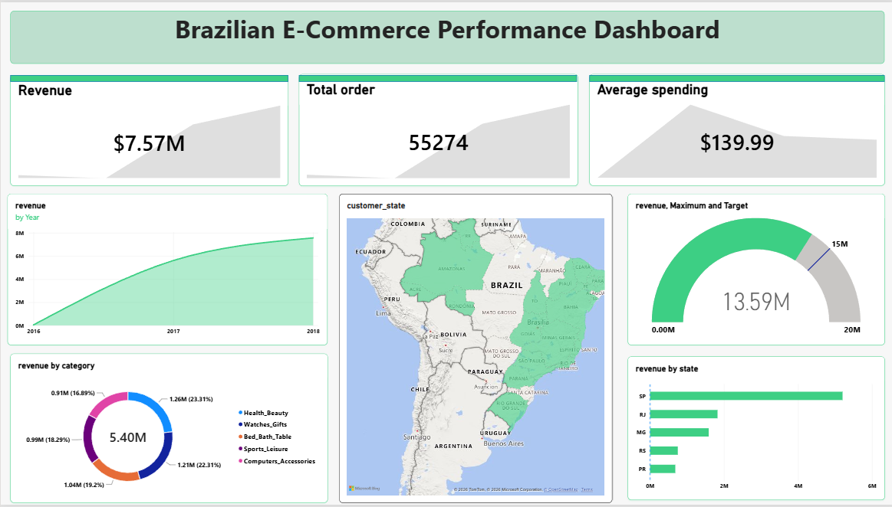
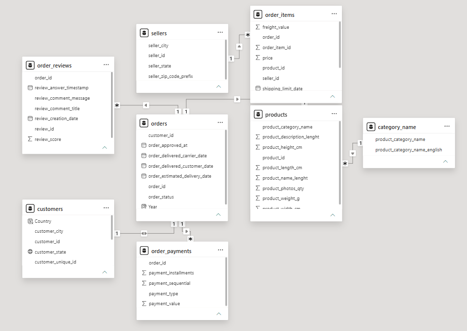

# Brazilian E-Commerce Performance Dashboard



## Overview
An end-to-end analysis of the Olist Brazilian e-commerce dataset (2016-2018, ~100K orders). SQL is used for data exploration and validation, and Power BI for the interactive dashboard covering revenue, orders, customer spending, product categories and geographic performance.

## Business Questions
- How has revenue changed from 2016 to 2018?
- Which states generate the most revenue?
- Which product categories perform best?
- How many orders are placed, and how much does an average customer spend?
- How does overall revenue compare against a target?

## Dashboard Contents
| Visual | What it shows |
|---|---|
| KPI cards | Revenue, number of orders, average spending (latest year, 2018 partial) |
| Area chart | Revenue trend by year |
| Filled map | Revenue distribution across Brazilian states |
| Bar chart | Revenue by state (SP, RJ, MG, RS, PR lead the ranking) |
| Donut chart | Revenue share of the top 5 product categories |
| Gauge | Total revenue (R$ 13.59M) against a target |

## Tools Used
- **SQL** : data checks, revenue and customer analysis
- **Power BI**: Power Query, data modeling, DAX, visualization
- **Dataset:** [Brazilian E-Commerce Public Dataset by Olist](https://www.kaggle.com/datasets/olistbr/brazilian-ecommerce)


## Data Model


Star-schema style model:
- `orders` linked to `customers` (`customer_id`)
- `orders` linked to `order_items`, `order_payments`, `order_reviews` (`order_id`)
- `order_items` linked to `products` (`product_id`) and `sellers` (`seller_id`)
- `products` linked to `category_name` (English category names)

## Key DAX Measures
```dax
revenue = SUM(olist_order_items_dataset[price])

Total Orders = COUNTROWS(olist_orders_dataset)

Unique Customers = DISTINCTCOUNT(olist_customers_dataset[customer_unique_id])

Avg Orders per Customer = DIVIDE([Total Orders], [Unique Customers])

Avg Revenue per Customer = DIVIDE([revenue], [Unique Customers])
```

## SQL Analysis
The file `sql/olist_analysis.sql` contains:
| Section | Queries |
|---|---|
| 1. Data checks | Row counts per table |
| 2. Revenue analysis | Total revenue, revenue by year, top 10 states by revenue |
| 3. Customer analysis | Unique customers, average orders per customer |
| 4. Category analysis | Top product categories by revenue |

Note: `customer_unique_id` identifies a real customer. `customer_id` changes with every order, so it is not used for customer counts.

## Key Insights
- Total item revenue is about **R$ 13.59M** across 2016-2018.
- Revenue grew strongly from 2016 to 2018 (2018 covers only part of the year).
- **São Paulo (SP)** leads all states by a wide margin, followed by RJ and MG.
- The top 5 categories (Health & Beauty, Watches & Gifts, Bed/Bath/Table, Sports & Leisure, Computers & Accessories) together account for about R$ 5.40M.
- Most customers place only one order, so the average orders per customer is close to 1.

## Limitations
- The KPI cards show the latest year in the data (2018), which is a partial year.
- Revenue uses item price only and excludes freight.
- The donut chart shows only the top 5 categories, not the full total.

## Repository Structure
```
├── README.md
├── data/            (link to Kaggle dataset)
├── sql/             olist_analysis.sql
├── powerbi/         olist_dashboard.pbix
└── images/          dashboard and data model screenshots
```
